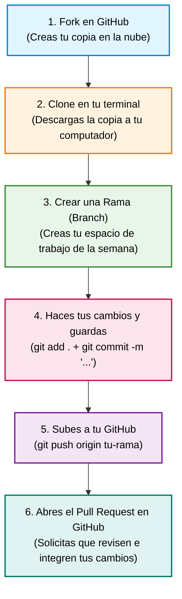

# 🤝 Guía para Principiantes: Cómo Contribuir a Fundamentos-Kubernetes

¡Qué alegría que quieras aportar! Aquí **cualquier mejora cuenta**: desde agregar tu nombre a la lista de asistentes hasta resolver un reto técnico de Kubernetes.

Si es tu primera vez usando **Git** o haciendo un **Pull Request (PR)** en GitHub, ¡respira tranquilo! Esta guía está diseñada paso a paso para que no te pierdas y aprendas haciendo.

---

## 🎯 3 Formas Fáciles de Empezar Hoy Mismo

1. **Regístrate en el Muro de Asistentes ([`ASISTENTES.md`](./ASISTENTES.md)):** Puedes hacerlo en 30 segundos usando nuestro **[⛵ Formulario Visual de Registro](https://github.com/edwinbermudez91/Fundamentos-Kubernetes/issues/new?template=registro-asistente.yml)** (¡el bot agregará tu foto y tus datos automáticamente sin errores!) o agregando tus datos en [`asistentes.json`](./asistentes.json) vía Pull Request. ¡Con este paso zarpas en el workshop!
2. **Solucionar un "Reto Roto":** En cada semana encontrarás una carpeta `2.reto-roto/` con manifiestos YAML que fallan a propósito.
   * ⚠️ **Regla de oro:** ¡Nunca modifiques los archivos originales de `2.reto-roto/`!
   * Crea una carpeta personal: `aportes-comunidad/soluciones-retos/<tu-usuario-github>/semana-XX/` y pega allí tu YAML corregido con comentarios `#` explicando el error y la solución.
3. **Compartir trucos o apuntes:** ¿Descubriste un comando útil o un alias genial? Agrégalo en [`aportes-comunidad/cheatsheets/`](./aportes-comunidad/cheatsheets).

> [!TIP]
> **🤖 Gamificación Automática:** ¡No te preocupes por cambiar tu rango a mano! Cada vez que un mentor apruebe y fusione uno de tus Pull Requests, nuestro bot de GitHub Actions contará tus aportes y actualizará automáticamente tu nivel en [`ASISTENTES.md`](./ASISTENTES.md):
> * ⛵ **Marinero:** 1 PR aprobado.
> * 🧭 **Timonel:** 3 PRs aprobados.
> * ⚓ **Capitán K8s:** 6+ PRs aprobados.

---

## 🚀 El Paso a Paso Ilustrado: Cómo Enviar tus Cambios (Pull Request)



---

### Paso 1: Haz un "Fork" (Tu copia en la nube)
1. Entra en tu navegador a la página principal del proyecto: [**edwinbermudez91/Fundamentos-Kubernetes**](https://github.com/edwinbermudez91/Fundamentos-Kubernetes).
2. Arriba a la derecha, haz clic en el botón que dice **Fork**.
3. Haz clic en **Create fork**. Ahora tendrás tu propia copia idéntica del repositorio en tu cuenta personal de GitHub.

---

### Paso 2: Descarga tu copia a tu computador (Clone)
Abre la terminal de tu computador y ejecuta estos comandos (reemplaza `TU-USUARIO` por tu nombre de usuario en GitHub):

```bash
git clone https://github.com/TU-USUARIO/Fundamentos-Kubernetes.git
cd Fundamentos-Kubernetes
```

*(Esto solo lo haces la primera vez que descargas el proyecto).*

---

### Paso 3: Crea una rama nueva para tu trabajo (Branch)
Una **rama** (*branch*) es una línea de trabajo independiente para no mezclar tus experimentos con la rama principal (`main`).

> [!TIP]
> **La regla de oro para no confundirte:**  
> Nombra tu rama usando siempre tu **usuario de GitHub** seguido de la semana:  
> `TU-USUARIO/semana-XX`  
> *(Por ejemplo, si tu usuario en GitHub es `carlos-dev`, tu rama será `carlos-dev/semana-01`). Esto evita colisiones y hace que tus aportes sean facilísimos de identificar.*

```bash
git checkout -b TU-USUARIO/semana-01
```

---

### Paso 4: Guarda tus cambios (`git add` y `git commit`)

Cuando edites archivos en VS Code y los guardes (`Cmd + S` o `Ctrl + S`), los cambios están en tu disco, pero Git todavía no los ha registrado en su historia oficial.

Para guardarlos en Git, ejecutas dos comandos:

#### 1. Prepara los cambios:
```bash
git add .
```
* **¿Qué hace?** El punto (`.`) le dice a Git: *"toma todos los archivos que acabo de modificar o crear en esta carpeta y colócalos en la caja listos para empacar"*.

#### 2. Sella y titula tu paquete:
```bash
git commit -m "Tu mensaje descriptivo aquí"
```

> [!IMPORTANT]
> **¿El mensaje entre comillas debe ser exactamente ese texto?**  
> **¡NO! Es solo un ejemplo.** El texto entre comillas es un mensaje libre donde tú describes brevemente lo que hiciste. Piensa en él como el asunto de un correo.

#### 📋 Tabla oficial: Ramas y mensajes para cada semana:

| Momento / Semana | Comando para crear tu rama (Usa tu usuario) | Comando de guardado (`commit`) con mensaje de ejemplo |
| :--- | :--- | :--- |
| **Registro inicial** | `git checkout -b TU-USUARIO/registro` | `git commit -m "Me registro como Marinero en ASISTENTES.md"` |
| **Semana 00 (Docker)** | `git checkout -b TU-USUARIO/semana-00` | `git commit -m "Solución al reto roto de Dockerfile semana 0"` |
| **Semana 01 (Pods)** | `git checkout -b TU-USUARIO/semana-01` | `git commit -m "Corrige error de imagen del pod rebelde semana 1"` |
| **Semana 02 (Deployments)**| `git checkout -b TU-USUARIO/semana-02` | `git commit -m "Solución al reto de réplicas y deployments semana 2"` |
| **Semana 03 (Redes)** | `git checkout -b TU-USUARIO/semana-03` | `git commit -m "Configura Service ClusterIP y puerto correcto semana 3"` |
| **Semana 04 (Almacenamiento)**| `git checkout -b TU-USUARIO/semana-04` | `git commit -m "Solución de ConfigMaps y PVC persistente semana 4"` |
| **Semana 05 (Seguridad/Probes)**| `git checkout -b TU-USUARIO/semana-05` | `git commit -m "Ajuste de sondas de salud livenessProbe semana 5"` |
| **Semana 06 (Helm/Proyecto)**| `git checkout -b TU-USUARIO/semana-06`| `git commit -m "Despliegue de Chart de Helm del proyecto final"` |
| **Aporte de Cheatsheet** | `git checkout -b TU-USUARIO/cheatsheet` | `git commit -m "Agrega alias útiles para kubectl logs en cheatsheet"` |

---

### Paso 5: Sube los cambios a tu GitHub (`git push`)
Envía la rama con tus cambios guardados desde tu computador hacia tu repositorio en la nube de GitHub:

```bash
git push origin TU-USUARIO/semana-01
```
*(Usa el mismo nombre de rama que creaste en el Paso 3).*

---

### Paso 6: Abre el Pull Request (PR) en GitHub
1. Abre tu navegador y entra a tu repositorio en GitHub: `https://github.com/TU-USUARIO/Fundamentos-Kubernetes`.
2. Verás una franja amarilla arriba que dice que tu rama tiene cambios recientes, con un botón verde que dice **"Compare & pull request"**. Haz clic en él.
3. Escribe un título breve (por ejemplo: *"Solución al reto de la semana 01 - @tu-usuario"*).
4. Haz clic en el botón verde **"Create pull request"**.

¡Listo! 🎉 En ese momento:
1. El bot de Cloud Native Medellín te dará la bienvenida automáticamente en los comentarios.
2. Un facilitador o mentor revisará tu aporte.
3. En cuanto hagan **Merge**, el bot de gamificación te ascenderá de rango automáticamente en [`ASISTENTES.md`](./ASISTENTES.md).

---

## ❓ Preguntas Frecuentes de Principiantes

<details>
<summary><b>1. ¿Tengo que hacer Fork y Clone cada semana?</b></summary>
<br>

**¡No!** El *Fork* y el *Clone* (Pasos 1 y 2) se hacen **una sola vez** al inicio del workshop.  
En las semanas siguientes (Semana 2, 3, 4, etc.) solo tienes que:
1. Volver a la rama principal: `git checkout main`
2. Traer los cambios nuevos del curso (ver pregunta 2 abajo).
3. Crear tu nueva rama para esa semana: `git checkout -b solucion-semana-02`
4. Hacer tus cambios, `git add .`, `git commit -m "..."`, `git push` y abrir el PR.
</details>

<details>
<summary><b>2. ¿Cómo descargo los nuevos ejercicios que el profesor suba al repositorio original?</b></summary>
<br>

A medida que avancen las semanas, el repositorio principal tendrá nuevos ejemplos y retos. Para traerlos a tu copia:
1. Entra a tu repositorio en GitHub desde el navegador: `https://github.com/TU-USUARIO/Fundamentos-Kubernetes`.
2. Verás un botón debajo del botón verde de código que dice **"Sync fork"**.
3. Haz clic en **"Sync fork"** y luego en **"Update branch"**.
4. En la terminal de tu computador ejecuta:
   ```bash
   git checkout main
   git pull origin main
   ```
¡Y listo! Tu computador tendrá todos los archivos y retos nuevos listos para practicar.
</details>

<details>
<summary><b>3. ¿Qué pasa si me equivoco en un archivo o cometo un error?</b></summary>
<br>

¡Absolutamente nada malo! **Este repositorio está hecho para romper cosas sin miedo y aprender.**  
Si algo no te cuadra o no compila, déjalo en el PR y pide ayuda en los comentarios; los mentores de la comunidad te guiarán con gusto.
</details>
