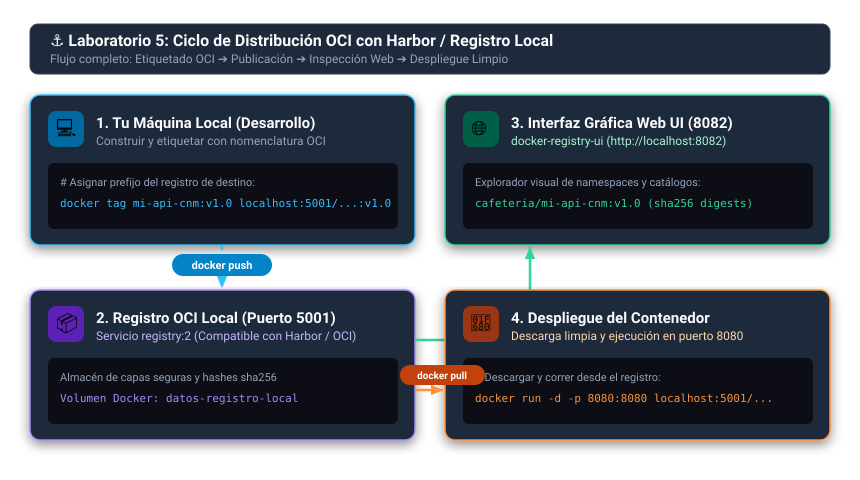

# ⚓ Ejemplo 05: Registro y Publicación de Imágenes con Harbor (Tag, Push y Pull)

En este laboratorio aprenderás cómo almacenar, versionar, escanear y distribuir de forma segura las imágenes que construiste en los laboratorios anteriores (`01`, `02`, `03` y `04`) utilizando **Harbor**, el registro de contenedores empresarial de código abierto graduado de la **CNCF**.

Aprenderás el ciclo de vida completo de distribución en Docker: cómo autenticarte con `docker login`, cómo renombrar tus imágenes locales con `docker tag`, cómo publicarlas con `docker push`, cómo inspeccionar el escaneo de vulnerabilidades con **Trivy** en la web de Harbor y cómo descargarlas y ejecutarlas en otro entorno con `docker pull`.

> [!NOTE]
> 📖 **Guía Teórica de Referencia:**  
> Para comprender la arquitectura interna de Harbor (Core, Jobservice, Registry, PostgreSQL, Redis), el despliegue con Helm y la analogía de la *Bodega Central de Café*, consulta la [**Guía Empresarial de Harbor**](../../../recursos/guia-harbor-registry.md).

---

## 🏗️ Ciclo de Distribución OCI Local



---

```text
05-registro-imagenes-harbor/
├── docker-compose.yml        # Entorno local de pruebas (Registry OCI + Web UI)
└── README.md                 # Esta guía paso a paso
```

---

## 🚀 Flujo Práctico Paso a Paso

### 1. Entorno de Registro para Practicar

Tienes dos formas de realizar este laboratorio:

* **Opción A (Instancia Empresarial / Servidor Harbor):**  
  Si tu organización o comunidad dispone de un servidor Harbor (ej: `https://harbor.mi-empresa.com`), usa esa URL y tus credenciales asignadas.
* **Opción B (Laboratorio Local Rápido):**  
  Si estás en tu propia máquina y deseas simular el registro con interfaz web de inmediato, levanta el registro local incluido en esta carpeta con Docker Compose:

  ```yaml
  # 📄 docker-compose.yml
  services:
    registry:
      image: registry:2
      container_name: registro-local
      restart: unless-stopped
      ports:
        - "5001:5000"
      environment:
        REGISTRY_STORAGE_DELETE_ENABLED: "true"
        REGISTRY_HTTP_SECRET: "secreto-registro-local-cnm"
        REGISTRY_HTTP_HEADERS_Access-Control-Allow-Origin: "['*']"
        REGISTRY_HTTP_HEADERS_Access-Control-Allow-Methods: "['HEAD', 'GET', 'OPTIONS', 'DELETE']"
        REGISTRY_HTTP_HEADERS_Access-Control-Allow-Headers: "['Authorization', 'Accept', 'Cache-Control']"
        REGISTRY_HTTP_HEADERS_Access-Control-Expose-Headers: "['Docker-Content-Digest']"
      volumes:
        - datos-registro:/var/lib/registry
      networks:
        - red-registro

    registry-ui:
      image: joxit/docker-registry-ui:2
      container_name: registro-ui
      restart: unless-stopped
      ports:
        - "8082:80"
      environment:
        - SINGLE_REGISTRY=true
        - REGISTRY_TITLE=Registro Local Cloud Native Medellín
        - DELETE_IMAGES=true
        - SHOW_CONTENT_DIGEST=true
        - NGINX_PROXY_PASS_URL=http://registry:5000
      depends_on:
        - registry
      networks:
        - red-registro

  volumes:
    datos-registro:
      name: datos-registro-local

  networks:
    red-registro:
      name: red-registro-local
  ```

  Para iniciarlo:
  ```bash
  docker compose -f semana-00-fundamentos-docker/1.ejemplos/05-registro-imagenes-harbor/docker-compose.yml up -d
  ```
  Esto levantará un registro OCI en el puerto `5001` y una interfaz gráfica web en **[http://localhost:8082](http://localhost:8082)**.

---

### 2. Autenticación en el Registro (`docker login`)

> 💡 **Nota para la Opción B (Registro Local):** Si estás utilizando el registro local de Docker Compose (`localhost:5001`), no necesitas autenticarte con `docker login` (no requiere contraseña). Puedes saltar directamente al **Paso 4**.

Para interactuar con un registro remoto o protegido, debes iniciar sesión desde tu terminal:

```bash
# Formato general:
docker login <host-del-registro> -u <usuario> -p <contraseña>

# Ejemplo con Harbor:
docker login harbor.cloudnative.local:8080 -u "admin" -p "Harbor12345"

# O usando el token de una Cuenta Robot (Buena práctica de seguridad):
docker login harbor.cloudnative.local:8080 -u "robot$ci-deployer" -p "tu-token-secreto"
```

> ✅ **Resultado exitoso:**
> ```text
> Login Succeeded
> ```

---

### 3. Crear el Proyecto en Harbor

> 💡 **Nota para la Opción B (Registro Local):** En el registro OCI local de Docker Compose, los proyectos/namespaces se crean de forma automática al hacer `docker push` hacia el prefijo correspondiente (ej. `localhost:5001/cafeteria/...`). No requieres crearlo manualmente; puedes saltar al **Paso 4**.

En la interfaz web de Harbor (Opción A):
1. Haz clic en **"+ New Project"** (Nuevo Proyecto).
2. Nómbralo: `cafeteria` (o el nombre de tu aplicación).
3. Selecciona el nivel de acceso:
   * **Private (Privado):** Recomendado en entornos reales. Solo usuarios autenticados pueden descargar (`pull`) o subir (`push`).
   * **Public (Público):** Cualquiera en la red puede descargar la imagen sin autenticarse.
4. Marca la casilla **"Automatically scan images on push"** para activar el escaneo automático de vulnerabilidades con Trivy.

---

### 4. Etiquetar las Imágenes de los Laboratorios Anteriores (`docker tag`)

Por defecto, Docker asume que una imagen sin prefijo pertenece a Docker Hub. Para indicarle que debe enviarse a Harbor o a tu registro local, el nombre de la imagen debe incluir la **URL del registro** y el **proyecto**:

> 🏷️ **Nomenclatura Obligatoria:** `<host-registro>/<proyecto>/<nombre-imagen>:<tag>`

Vamos a etiquetar las imágenes que construiste en los ejemplos anteriores (`01`, `02`, `03` y `04`):

```bash
# Si estás usando el registro local con Docker Compose (Opción B):
REGISTRO="localhost:5001"
PROYECTO="cafeteria"

# Si estás usando un servidor Harbor empresarial / remoto (Opción A):
# REGISTRO="harbor.cloudnative.local:8080"
# PROYECTO="cafeteria"

# 1. Imagen del Servidor Web Nginx (Ejemplo 01)
docker tag mi-web-estatica:v1.0 ${REGISTRO}/${PROYECTO}/mi-web-estatica:v1.0

# 2. Imagen de la API REST de Python (Ejemplo 02)
docker tag mi-api-cnm:v1.0 ${REGISTRO}/${PROYECTO}/mi-api-cnm:v1.0

# 3. Imagen del Backend de Microservicios (Ejemplo 03)
docker tag greca-backend:v1.0 ${REGISTRO}/${PROYECTO}/greca-backend:v1.0

# 4. Imagen de la App con Almacenamiento (Ejemplo 04)
docker tag app-ventas:v1.0 ${REGISTRO}/${PROYECTO}/app-ventas:v1.0
```

Verifica las nuevas etiquetas creadas en tu máquina:
```bash
docker images | grep ${PROYECTO}
```

> 💡 **Nota:** `docker tag` no duplica el peso en tu disco; simplemente crea un alias o puntero hacia las mismas capas que ya tenías compiladas.

---

### 5. Subir las Imágenes al Registro (`docker push`)

Ahora publicamos la imagen en Harbor:

```bash
docker push ${REGISTRO}/${PROYECTO}/mi-api-cnm:v1.0
```

Salida esperada:
```text
The push refers to repository [harbor.cloudnative.local:8080/cafeteria/mi-api-cnm]
7b9231f82e88: Pushed 
c24239841f3e: Pushed 
e19df2d63421: Pushed 
v1.0: digest: sha256:4d87a412b1... size: 949
```

> ⚡ **Eficiencia de Capas:** Si luego subes `greca-backend:v1.0` (que también está basada en `python:3.12-alpine`), verás que Docker indica `Layer already exists` y no vuelve a transferir los megabytes de la base por la red.

Sube las demás imágenes:
```bash
docker push ${REGISTRO}/${PROYECTO}/mi-web-estatica:v1.0
docker push ${REGISTRO}/${PROYECTO}/greca-backend:v1.0
docker push ${REGISTRO}/${PROYECTO}/app-ventas:v1.0
```

---

### 6. Inspección de Artefactos y Escaneo de Seguridad

Dependiendo de qué opción estés usando, la experiencia visual es diferente:

#### 🌐 En la UI del Registro Local (Opción B: `Docker Registry UI`)
Al ingresar a **[http://localhost:8082](http://localhost:8082)** observarás:
1. **Repositorios y Tags:** El espacio de nombres `cafeteria/` agrupando tus imágenes (`mi-api-cnm`, `greca-backend`, `mi-web-estatica`, `app-ventas`).
2. **Digest Criptográfico:** El hash inmutable `sha256:b9b4ef6d...` que garantiza la integridad del contenido.
3. **Detalles de Capas:** Tamaño (`18 MB`), arquitectura (`amd64`) e historial de capas de cada tag.

> ℹ️ **¿Por qué no aparece el "Escudo de Vulnerabilidades" en esta web?**  
> `docker-compose.yml` levanta un stack ultraligero compuesto por el registro OCI oficial de Docker (`registry:2`) y una interfaz gráfica comunitaria (`docker-registry-ui`). Este visor **no** integra un motor de análisis estático como Trivy (Harbor requiere más de 7 contenedores: PostgreSQL, Redis, Core, Jobservice, Trivy-adapter, etc., consumiendo más de 4 GB de RAM).
>
> 🛡️ **¿Cómo escanear las vulnerabilidades con Trivy en tu máquina local?**  
> Puedes ejecutar el motor de Trivy directamente por terminal contra cualquiera de tus imágenes:
> ```bash
> # Escanear la imagen local con Trivy:
> docker run --rm -v /var/run/docker.sock:/var/run/docker.sock aquasec/trivy:latest image mi-api-cnm:v1.0
> 
> # O usando Docker Scout (si está disponible en tu cliente Docker):
> docker scout cves mi-api-cnm:v1.0
> ```
> Verás el reporte completo en consola confirmando que, gracias a `python:3.12-alpine`, obtienes **0 vulnerabilidades de severidad alta o crítica**.

#### ⚓ En la Web de Harbor Empresarial (Opción A)
Si tu empresa o laboratorio cuenta con una instancia completa de Harbor:
1. **Artefactos OCI:** Verás el proyecto `cafeteria` con el repositorio `mi-api-cnm` y el tag `v1.0`.
2. **Escudo de Vulnerabilidades (Trivy Integrado):** En la columna *Vulnerabilities* verás el badge interactivo con el semáforo de seguridad generado automáticamente por Trivy al hacer push.
3. **Política de Prevención de Vulnerabilidades:** En la pestaña **Configuration** de tu proyecto, puedes activar *"Prevent vulnerable images from running"*. Si una imagen supera el umbral configurado, Harbor bloqueará automáticamente cualquier intento de `docker pull`.

---

### 7. Probar la Descarga y Ejecución en una Máquina Limpia (`docker pull`)

Simulemos que estás en otro servidor donde la imagen no existe:

1. Elimina la copia local de la imagen de tu máquina para forzar la descarga:
   ```bash
   docker rmi ${REGISTRO}/${PROYECTO}/mi-api-cnm:v1.0
   ```

2. Descarga la imagen fresca desde Harbor:
   ```bash
   docker pull ${REGISTRO}/${PROYECTO}/mi-api-cnm:v1.0
   ```

3. Corre el contenedor a partir de la imagen descargada del registro:
   ```bash
   docker run -d -p 8080:8080 --name test-harbor ${REGISTRO}/${PROYECTO}/mi-api-cnm:v1.0
   ```

4. Prueba que la aplicación responde correctamente:
   ```bash
   curl http://localhost:8080
   ```

---

### 8. Limpieza

Detén y elimina el contenedor de prueba:
```bash
docker rm -f test-harbor
```

Si levantaste el entorno local de prueba con docker compose:
```bash
docker compose -f semana-00-fundamentos-docker/1.ejemplos/05-registro-imagenes-harbor/docker-compose.yml down -v
```

---

## 🌉 ¿Por qué hacemos esto? (Preparándonos para la Semana 1: Kubernetes)

En este laboratorio trabajamos **100% con Docker**. Pero podrías preguntarte:
> *¿Por qué no simplemente correr contenedores con `docker run` en mi propia máquina? ¿Para qué subir imágenes a un registro como Harbor?*

| En Docker (Hoy) | En Kubernetes (A partir de la Semana 1) |
| :--- | :--- |
| Corres el contenedor en tu propio computador con `docker run`. | El clúster corre tus contenedores en **decenas de servidores remotos (Worker Nodes)**. |
| Tu máquina física tiene el código fuente y el `Dockerfile`. | Los servidores del clúster **NO** tienen tu código local; solo tienen acceso a la red. |
| Subes la imagen manualmente con `docker push`. | Kubernetes descarga automáticamente (`pull`) estas mismas imágenes de Harbor para encender réplicas en cualquier nodo. |
| Usas `docker login` en tu terminal personal. | Kubernetes se autentica contra Harbor usando una credencial llamada **`imagePullSecrets`**. |

¡Todo lo que aprendiste hoy sobre `docker tag`, `docker push`, deduplicación de capas y escaneo en Harbor es exactamente lo que necesitarás cuando construyamos nuestro clúster en la siguiente semana!

---

## 🧠 Conceptos Clave Aprendidos

| Concepto | ¿Por qué es fundamental? |
| :--- | :--- |
| **Nomenclatura OCI** | Todo tag de Docker debe llevar el prefijo `<host>/<proyecto>/<imagen>:<tag>` para saber a qué registro enrutar el push. |
| **Reutilización de Capas** | Los registros OCI solo descargan y suben capas que no existan previamente, ahorrando ancho de banda y tiempo. |
| **Cuentas Robot (Robot Accounts)** | Evitan exponer credenciales humanas personales en pipelines automatizados. |
| **Vulnerability Prevention** | Políticas que bloquean automáticamente la descarga de imágenes con fallos de seguridad detectados por Trivy. |
| **Ciclo Completo** | `docker build` ➔ `docker tag` ➔ `docker push` ➔ `docker pull` ➔ `docker run`. |

---

> 📖 **Guía Complementaria:** Si deseas conocer a fondo la arquitectura interna de Harbor o aprender cómo se instala en un clúster con Helm, consulta la [**Guía Empresarial de Harbor**](../../../recursos/guia-harbor-registry.md).
